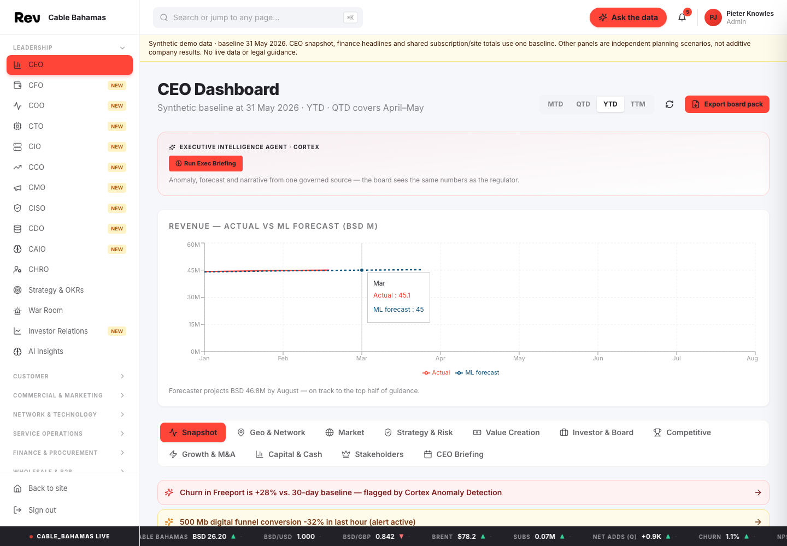
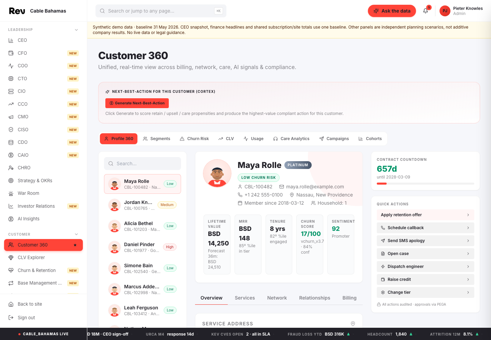
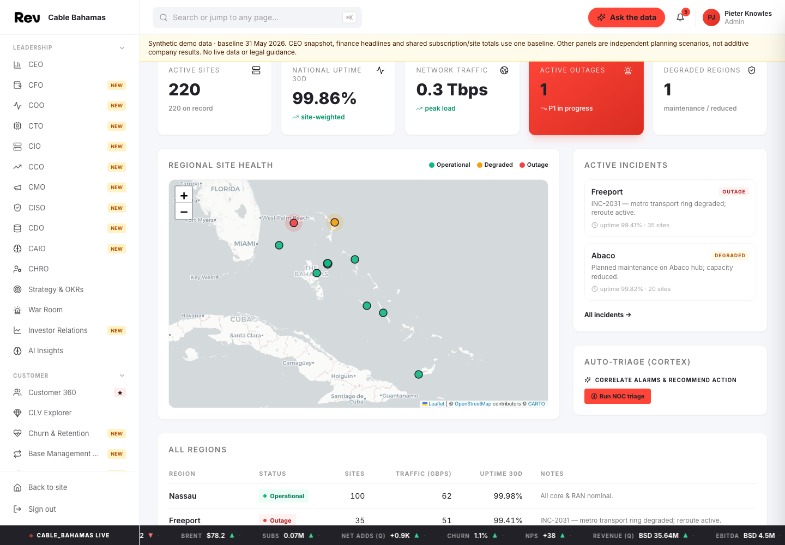

# Cable Bahamas C360

A React 18, TypeScript and Vite demonstration for exploring customer, financial and network scenarios, paired with a separate read-only Snowflake Intelligence agent for fixed-service analytics.

## Links

| Resource | Link | Access |
| --- | --- | --- |
| Live demo | [Cable Bahamas C360](https://pmjose.github.io/CableBahamas/) | Public; demonstration entry code below |
| Source repository | [pmjose/CableBahamas](https://github.com/pmjose/CableBahamas) | Public |
| Deployment workflows | [GitHub Actions](https://github.com/pmjose/CableBahamas/actions) | Public |
| Snowflake Intelligence / CoWork | [Open Snowflake Intelligence](https://ai.snowflake.com) | Account-restricted; select the deployed agent in your authorized account |
| Local development | [Development server](http://localhost:5173/CableBahamas/) | Local machine; start the app first |
| Production preview | [Local build preview](http://localhost:4173/CableBahamas/) | Local machine; build and start preview first |
| Application audit | [AUDIT.md](AUDIT.md) | Repository documentation |
| Rebrand verification | [VERIFICATION.md](VERIFICATION.md) | Repository documentation; historical verification record |
| Agent setup | [Snowflake deployment notes](snowflake/README.md) | Local project files; not yet committed with the public demo |
| Agent evaluation | [Evaluation and limitations](snowflake/EVALUATION.md) | Local project files; not yet committed with the public demo |
| Brand reference | [REV](https://www.rev.bs/) | Public; logo and palette reference, not endorsement |

## Business Description And Process

The demonstration is intended for executive, customer-care, finance, network-operations and B2B teams evaluating how customer context and analytical questions can support decisions. The web demo covers the Cable Bahamas group: **REV fixed broadband, television, fixed voice and business connectivity**, plus **aliv mobile** in a separately labelled sidebar group. The Snowflake agent covers fixed services only.

There are two independent experiences:

| Experience | What it does | Data and execution |
| --- | --- | --- |
| Public web demo | Dashboards, Customer 360, Bahamas network maps and interactive scenarios | Browser-only fixtures; AI buttons and the in-app chat are scripted simulations |
| Snowflake Intelligence agent | Queries customers, finance, support, network, billing, pipeline and product economics; creates charts when useful | Real SQL execution over separately generated synthetic Snowflake tables and seven semantic views |

**The public app is not connected to the Snowflake agent.** Their datasets and totals are independent and must not be compared as if they were one system. Mobile pages (RAN, spectrum, 5G core, slicing, portability, MVNO, roaming, handsets) are grouped under **aliv Mobile** in the sidebar. The Snowflake agent excludes mobile, aliv, SIMs, RAN, 5G, spectrum and roaming, so skip that group when you pair the web demo with the agent.

Typical demonstration flow:

1. Review executive indicators and identify a customer, financial or service issue.
2. Drill into fictional customer records, billing context or island-level network scenarios.
3. Explore a retention, product or operational scenario without executing real business actions.
4. In the separate Snowflake Intelligence interface, ask a supported fixed-services question.
5. Review the tool-backed answer, period, BSD units, source and chart before drawing conclusions.

All records, prices, forecasts, benchmarks and operational metrics are **synthetic**, not company disclosures. The reference date is **31 May 2026**. The website's independent planning panels are not an additive company-wide model. Regulatory workflows are illustrative, not legal advice. REVConnect and REVHome are fictional bundle labels, not official offers. This is an independent demonstration, not an official Cable Bahamas application.

## Screenshots

Captured from the public web demo on 23 September 2026. These show the existing website, not the separate Snowflake Intelligence interface. Labels such as "live", "Cortex" or "forecast" in these screens describe simulated workflows, not live integrations.

### Executive Dashboard



### Customer 360



### Bahamas Network Map



## Prerequisites

- Node.js **24** and npm, matching the deployment workflow.
- Git for cloning and contributing changes.
- A browser-scoped CARTO basemap credential for map tiles. The rest of the web app runs without it; missing credentials display a map configuration warning.
- For the agent only: an authorized Snowflake account, access to the deployed agent and underlying resources, and a query warehouse. Local web development does not require Snowflake.

## Quick Start

From the repository root after cloning the source linked above:

```bash
npm ci
npm run dev -- --host 127.0.0.1
```

Open the local development link in the Links table. Enter **`CableBahamas2026`** at the demo gate.

Run the checks and production preview:

```bash
npm test
npm run build
npm run preview -- --host 127.0.0.1 --port 4173
```

The preview command is provided by the project's npm scripts; it has not been separately smoke-tested in this documentation pass.
<!-- unverified: npm run preview -- --host 127.0.0.1 --port 4173 -->

The entry code is hard-coded client-side and is **not authentication**. Do not place confidential information in this public application.

## Usage

### Web Demo

Use the sidebar to navigate leadership, customer, commercial, operations and data-platform scenarios. Customer 360 contains fictional contacts using reserved email addresses. National maps fit the Bahamas; customer maps use approximate town locations rather than actual service addresses. The transit scenario includes explicitly labeled Florida endpoints.

The application's "Ask the data" and other AI controls simulate interactions. They do not call the deployed Snowflake agent or modify real business records. For a fixed-services-only story, skip the **aliv Mobile** sidebar group.

Regulatory and market context is Bahamian: URCA, the Data Protection Act (ODPC), Central Bank of The Bahamas, NEMA hurricane resilience, BISX, a BSD pegged 1:1 to the USD, BTC as the named competitor and fictional "Rival ISP A/B/C" for other operators. `tests/rebrand.test.ts` fails if European regulation, institutions or placeholders reappear.

### Snowflake Intelligence Agent

Select **Cable Bahamas Fixed Services Intelligence** in the authorized Snowflake Intelligence account.

| Object | Identifier |
| --- | --- |
| UI-facing agent | `SNOWFLAKE_INTELLIGENCE.AGENTS.CABLE_BAHAMAS_AGENT` |
| Original agent | `CABLEBAHAMAS_DEMO.ANALYTICS.CABLE_BAHAMAS_AGENT` |
| Data and semantic views | `CABLEBAHAMAS_DEMO.ANALYTICS` |
| Query warehouse | `DC_WAREHOUSE` |

Both agent copies use the same seven semantic views. Keep their specifications synchronized when changing instructions. The initial deployment is owner-access only; other users require explicit least-privilege access. Do not grant end users an administrative role simply to use the agent.

Example questions:

- What was revenue and EBITDA in May 2026?
- How has monthly revenue changed from June 2025 through May 2026?
- Which customers have high modeled churn risk?
- How many fixed-network sites are there by island?
- How much debt is more than 60 days overdue?
- What is the open and probability-weighted B2B pipeline?
- Which fixed-service products have the largest direct monthly margin?

The agent is instructed to generate native charts when useful: lines for trends, bars for comparisons, stacked bars for additive composition and scatter plots for relationships. Charts use query results, labeled units and periods. Single values, missing data and unsupported questions remain text. Geographic questions use island comparisons rather than geographic charts in Intelligence.

Actual historical churn events, campaign ROI, field-work orders, pricing elasticity and predictive forecasts are not loaded. Churn-risk scores and modeled CLV are not observed churn outcomes. The agent has analytical tools only, with no write-action tools.

## Configuration

| Setting | Purpose | Handling |
| --- | --- | --- |
| `VITE_CARTO_BASEMAP_KEY` | Browser basemap credential consumed by the Vite build | Supply through the approved secret manager or CI environment; never commit its value |
| `CARTO_BASEMAP_KEY` | GitHub Actions repository secret | Workflow maps it to the Vite build variable |
| `/CableBahamas/` | Vite asset base | Configured in `vite.config.ts`; retain for the project Pages URL |
| Hash routing | Client-side route navigation | Allows direct portal links on GitHub Pages |
| `src/data/scenario.ts` | Web demo's shared baseline and financial history | Separate from the Snowflake agent dataset |
| `snowflake/` | Agent SQL, tracked specifications, generator and evaluation files | Local additions awaiting a separate commit; deployment requires authorized Snowflake access |

For local map setup in Cortex Code, use `/secrets` to manage the credential and ask the assistant to start the app with the stored key. Do not paste credentials into chat or source files.

The CARTO key is intentionally **browser-visible** in deployed JavaScript and tile requests, even when supplied through an encrypted Actions secret. Limit it to basemap permissions and approved origins. Provider-side restrictions were not verified. CARTO and OpenStreetMap attribution must remain visible.

GitHub Actions runs tests, checks the basemap secret, builds the application and deploys GitHub Pages on pushes to `main` or manual workflow dispatch. Build output and dependencies are ignored by Git. No server-side database credentials belong in the public build.

## Status, License And Contributing

- The web demo is deployed through GitHub Actions. The latest application audit recorded **15 passing tests**, a passing production build and no dependency advisories at the time of that audit; these are dated results, not continuous guarantees.
- The agent's curated benchmark passed **12 supported data questions and 3 boundary checks**, followed by a provenance retest. Automatic chart generation was separately verified with a revenue-trend question. This does not establish accuracy on all unseen questions.
- Known follow-ups: connect the web app to the agent only through an authenticated backend; configure non-administrative viewer access; commit the local Snowflake artifacts after review.
- No license file is currently provided. Do not assume open-source reuse rights. Brand assets remain subject to their owners' rights.
- No contribution guide is present. Discuss proposed changes with the repository owner before submitting them.
